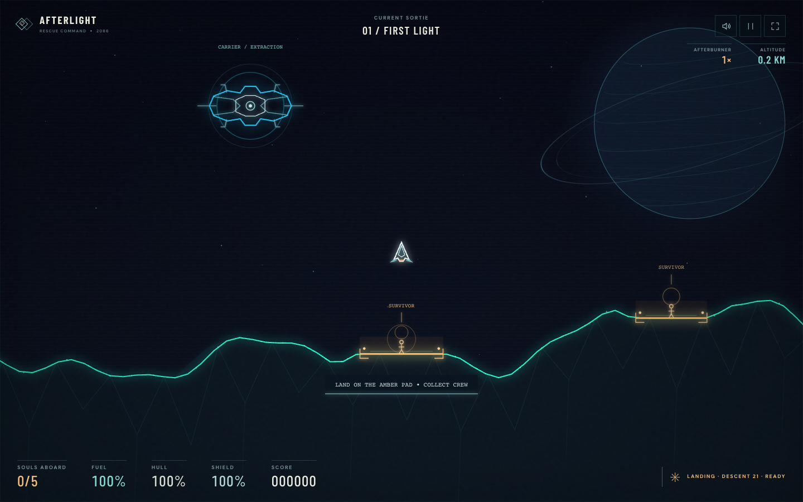
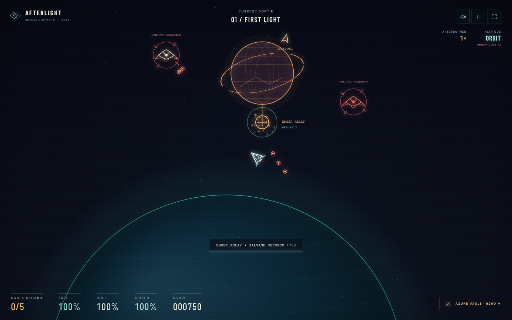
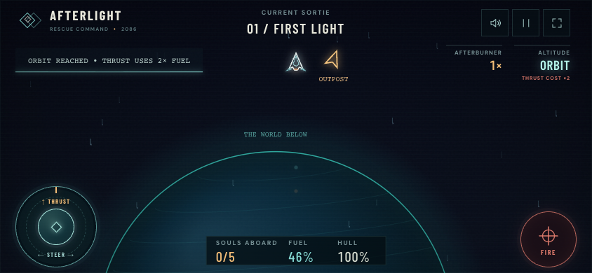

# AFTERLIGHT — Rescue Protocol

An original browser game about gravity flight and rescuing stranded crews. Inspired by the rescue mechanics of Oids and the color-vector arcade tradition. All geometry and sound are generated in the browser.

[Play AFTERLIGHT](https://afterlight.45-77-127-32.nip.io)



## Run locally

From this directory:

```sh
python3 -m http.server 4173 --directory dist
```

Open http://localhost:4173. The game itself is static and has no build step; Node and Playwright are only used by the optional browser QA scripts.

## Optional browser QA

Install the test tools, then run the checks in a second terminal while the server is running:

```sh
npm ci
npx playwright install chromium
npm run qa
```

To run an individual check, use `npm run qa:smoke`, `npm run qa:joystick`, `npm run qa:playloop`, `npm run qa:campaign`, `npm run qa:combat`, `npm run qa:edges`, `npm run qa:wrap`, `npm run qa:audio`, `npm run qa:balance`, or `npm run qa:expedition`. Set `CHROME_PATH` to a local Chrome or Chromium executable to use it instead of Playwright's bundled Chromium. The smoke check accepts an optional base URL as its first argument.

## Flight controls

| Action | Desktop |
| --- | --- |
| Turn | Left/right arrows or A/D |
| Thrust | Up arrow or W |
| Fire | Space |
| Shield | Shift |
| Pause | P or Escape |
| Restart current sortie | R |

Mobile uses a left virtual joystick and one FIRE button on the right. Drag up for thrust, sideways to steer, or diagonally to do both; use the other thumb to fire. Release the stick to coast. Fly in either direction through a continuous, wrapping landscape. Follow amber rescue beacons, land gently, then carry the crew back to the blue extraction ship. A sector clears only when every stranded person is safely delivered. Rescue pads provide a fuel top-up, and the carrier refuels and repairs your ship.

Holding thrust builds progressively stronger afterburner stages: 1.5× power after one second, 1.75× after two, and up to 6.25× after ten. Longer exhaust trails and a rising engine roar show the escalation. Higher power uses more fuel; releasing thrust preserves momentum, so turn and thrust against your velocity to brake. The desktop shield has a separate two-second reserve and recharges over fourteen seconds after a short delay. Release Shift to begin recharging and rearm it. Use it for a brief escape through enemy fire. Red ground sentries and flying interceptors can both be destroyed. Hard landings damage the hull; slow down before touching a rescue pad.

Climb for an extended burn of just over ten seconds to reach space at roughly 5.5 km and see the planet below. An approach warning gives you time to release thrust and coast into orbit. Spaceflight consumes fuel at twice the current throttle rate. The cockpit warns when fuel falls below 20%. Motion trails in the starfield help judge your direction and speed. Releasing thrust conserves fuel while you coast; turn back toward the surface to return. As you travel farther, the homeworld shrinks into a distant globe.

Two optional planetoid outposts offer refuelling, repairs, and salvage bonuses. Follow their beacons, brake for docking, and watch for tougher sentinels that fire spread volleys. Each outpost awards salvage once per sector; visiting it again can replenish supplies. Homeworld rescues still determine sector completion, so space exploration remains an optional detour.





Each sector is a large circular world: keep flying left or right and you eventually return to familiar terrain. The terrain repeats seamlessly, while each survivor and sentry keeps its state. The renderer draws only the visible landscape and nearby objects, and temporary effects have fixed limits, so completing more laps does not accumulate world data.

## Source

- `dist/game.js`: flight simulation, missions, vector renderer, input and game interface.
- `dist/audio.js`: procedural Web Audio effects, including layered bass exhaust with smooth ignition and release.
- `dist/index.html`, `dist/style.css`: responsive interface.
- `dist/fonts.css`, `dist/fonts/`: bundled Barlow Condensed and DM Sans, with their SIL Open Font License notices.
- `qa/`: browser verification scripts, selected screenshots, and reports.

The game stores score and sound preference in browser-local storage when available. It does not require accounts, a game server, analytics, or remote assets.

## Vultr hosting

The public game runs on the existing Vultr host, with HTTPS provided by Caddy. `deploy/server.py` serves only `dist` on loopback; it needs Python 3.9 or newer and no third-party packages. To try that server locally:

```sh
python3 deploy/server.py --port 4173
python3 -m unittest discover -s deploy -p 'test_*.py'
```

The configuration in `deploy/vultr/` matches this host's managed deployment contract. It uses a dedicated app user, a reserved port, hardened service settings, and Caddy's own site file. Credentials and SSH keys are not part of this repository.

On the configured host, stage a clean, committed repository export under your own `/srv/_staging/<agent>/afterlight/`, then run:

```sh
sudo deploy afterlight --smoke /srv/_staging/<agent>/afterlight
sudo deploy afterlight --from /srv/_staging/<agent>/afterlight
sudo deploy afterlight --status
```

Each deploy creates an immutable release, switches it atomically, checks `/healthz`, and reverts to the previous release if the check fails. An intentional rollback uses `sudo deploy afterlight --rollback`. Caddy configuration changes go through `sudoedit /etc/caddy/sites.d/afterlight.caddy` and `sudo caddy-apply`; leave other sites' files alone. New game releases do not require a Caddy change.

## Team workflow

The initial build used bounded programming, visual design, and playtesting roles, followed by integrated reviews and repairs. Continue this workflow for substantial changes: delegate suitable tasks to cheaper capable agents, keep file ownership clear, review actual desktop/mobile play, and integrate the results before delivery.
